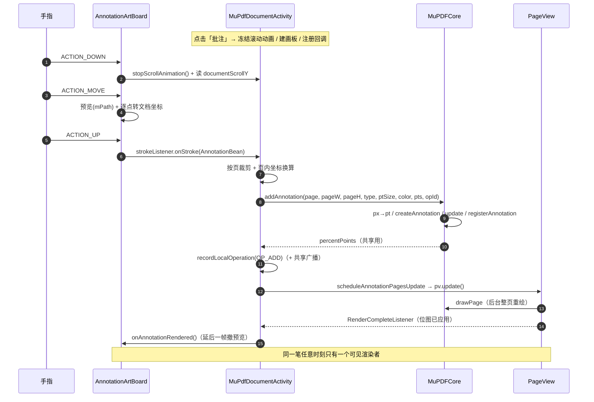

# 批注（Annotation）实现流程说明

> 适用范围：`:mupdf` 模块。批注采用 **即时保存（写进 PDF 标注对象）** 方案，
> 屏幕上的画笔浮层只负责手感与预览，真正的批注由 MuPDF 渲染进页面位图。
> 本文按"一次批注会话从开启到落盘"的真实调用链整理，供维护/交接使用。

---

## 1. 三层结构

| 层 | 职责 | 关键类 |
|---|---|---|
| 画板层 | 采集手势、屏幕坐标预览、本地位图擦除；**不直接操作 PDF** | `com.artifex.mupdf.annotation.AnnotationArtBoard` |
| 协调层 | 会话状态、坐标换算、按页切分、撤销/取消/共享、落盘 | `com.xlk.mupdf.library.MuPdfDocumentActivity` |
| 内核层 | 创建/删除/查询 PDF 标注对象 | `com.artifex.mupdf.viewer.MuPDFCore` + `com.artifex.mupdf.fitz.PDFAnnotation` |
| 视图层 | 页面位图渲染与滚动；为浮层提供几何信息与重绘通知 | `ReaderView` / `PageView` |

一句话数据流：

```
手指 → 画板(屏幕坐标预览) → 文档坐标点 → 按页裁剪 → 页内坐标
     → PDF 点 → PDFAnnotation(Line/Ink/Highlight/…) → 页面重绘显示
     → 记录操作(用于撤销/共享) → 退出时增量保存
```

---

## 2. 会话生命周期

### 2.1 开启批注

入口：顶部工具栏「批注」按钮（`viewTopAnnotation`，需 `MupdfConfig.annotationEnable = true`）。

1. `mDocView.savePosition()`：记录当前页方位（退出后恢复用）；
2. `mDocView.stopScrollAnimation()`：**冻结惯性/翻页滚动动画**。
   > 原因：画板覆盖在 PDF 之上并吃掉所有触摸，`ReaderView.onDown()` 中的
   > `mScroller.forceFinished(true)` 永远不会执行；不冻结的话，正在进行的
   > fling / 翻页动画会带着文档在手指下继续滑动。
3. `hideButtons()` + `showAnnotationViews()` → `mDocView.setAnnotation(true)`（此后 ReaderView 不再拦截触摸）；
4. 销毁旧画板（`removeView` + `recycleBitmapOnly`），`chooseType(1)` 默认选中「画笔」；
5. `new AnnotationArtBoard(this, core, mDocView, artW, artH)`，其中
   `artW = mDocView.getWidth()`、`artH = mDocView.getHeight()`；
6. `setDocumentScrollY(mDocView.getDocumentScrollY())`、`setPaintWidth(default_ink_size /* =3 */)`；
7. 注册 4 个回调（画板与 PDF 之间**唯一**的交互面）：
   - `setStrokeListener`：每一笔完成 → 立即写入 PDF；
   - `setEraseListener`：擦除完成 → 同步删除已写入的批注；
   - `setTextMarkupListener`：下划线/删除线 → 走文字 quad 提取；
   - `setFreeTextListener`：自由文本 → 弹输入框。
8. `rootView.addView(artBoard, 1)` + `artBoard.layout(0, 0, artW, artH)`；
   层级顺序：`0 = mDocView`、`1 = 画板`、`2 = 按钮层`（工具栏仍可点）；
9. 记录会话基线（退出时靠它区分"本次批注"）：
   - `hadAnnotationBeforeCurrentSession`
   - `annotationSessionStartIndex = savedAnnotationPages.size()`
   - `annotationOperationSessionStartIndex = localOperationIds.size()`

### 2.2 手势与坐标

`AnnotationArtBoard.onTouchEvent` 的路由：

```
pointerCount > 1 || isMultiTouching  →  handleMultiTouch()   // 双指平移文档
else if (drag)                       →  drag()               // 拖动画板
else                                 →  draw()               // 绘制
```

- **落笔前**：`docView.stopScrollAnimation()` + 刷新 `documentScrollY`（坐标基准）；
- **双指**：丢弃进行中的单指笔画，`docView.scrollBy(dx, -dy)` 平移文档（只平移、不缩放），并 `invalidate()`；
- **坐标换算**：`文档点 = 屏幕点 + docView.getDocumentScrollY()`
  - 曲线（`DRAW_SLINE`）在**每个 MOVE 都重读一次滚动值**（`toDocumentPoint()`）；
  - 直线/矩形等只取按下、抬起两个基准点（`startDocY` / 抬起时的 `documentScrollY`）。
- **实时预览**（`onDraw`）：先画位图（按 `bitmapScrollY - 当前滚动` 平移，使已提交笔画跟随文档），再画 `mPath`；曲线用 `quadTo` 中点平滑；
- **预览线宽**：`resolvePreviewWidthPx() = (paintWidth / 3f) × 页面 px/pt`
  —— 必须与最终批注在屏幕上的宽度一致，否则"预览 → 批注"交接瞬间笔画会突然变粗/变细（表现为闪一下）；
- **擦除**（`DRAW_ERASER`）：MOVE 时既做本地位图擦除，也立刻按坐标删除内核里的真实批注。

### 2.3 一笔提交（即时保存）

`ACTION_UP` → `draw()` 内组数据 → 回调 → 写 PDF：

1. **组 `AnnotationBean`**（坐标已是文档坐标）：
   | 工具 | PDF 类型 |
   |---|---|
   | 画笔 `DRAW_SLINE` | `TYPE_INK` |
   | 直线 `DRAW_LINE` | `TYPE_LINE` |
   | 删除线 `DRAW_DELLINE` | `TYPE_LINE`（固定 3f / `delLineColor`） |
   | 高亮/矩形 `DRAW_RECT` | `TYPE_HIGHLIGHT` |
   | 下划线 / 删除线（文字） | `TYPE_UNDERLINE` / `TYPE_STRIKE_OUT`（走 `textMarkupListener`） |
   | 自由文本 `DRAW_FREETEXT` | `TYPE_FREE_TEXT`（走 `freeTextListener`） |
2. `strokeListener.onStroke(last)` → `MuPdfDocumentActivity.addStrokeAnnotation(bean, artH, segments)`；
3. **线宽换算**：`paintSize = paintWidth / 3f`（px → pt 的经验值，UI 粗细与 PDF 线宽无严格物理对应）；
4. **按页切分**（跨页关键）：
   - 直线：`addLineAnnotationByPages()` —— 遍历全部页，用 `getPageDocTop(p)` 与
     `pageTop + getAnnotationPageHeight(p)` 求线段与页的交集参数 `t0/t1`，插值得到页内起止点；
   - 墨迹：`addInkAnnotationByPages()` → `splitInkByPages()` → 对每对相邻采样点
     `clipLineToPages()`，把一笔拆成"每页一段"；
   - 其它：`addSinglePageAnnotation()`；
5. **屏幕 → 页内**：`toPageLocalPoint(p, pageIdx) = (p.x - getPageScreenLeft(pageIdx), p.y - getPageDocTop(pageIdx))`
   - `getAnnotationPageWidth()` = 子 View 实测宽度（拿不到时回退 `mDocView.getWidth()`）
   - `getAnnotationPageHeight()` = `getPageDisplayHeight()`（拿不到时回退 `artH`）
6. **写入 PDF**：`MuPDFCore.addAnnotation(pageIdx, pageW, pageH, type, ptSize, color, localPts, operationId)`
   - `realWidth/realHeight = page.getBounds()`；
   - 页内像素 → PDF 点：`x × realWidth / pageW`、`y × realHeight / pageH`；
   - **MuPDF 的 annot API 使用 doc space（原点页左上、y 向下）**，与屏幕方向一致，因此不做 y 翻转；
   - `createAnnotation()` 分派：
     `TYPE_LINE` → `setBorderWidth + setLine`；
     `TYPE_SQUARE` → `setBorderWidth + setRect`；
     `TYPE_HIGHLIGHT` → `setOpacity(0.5) + setQuadPoints`；
     默认（INK） → `addInkList`；
   - `annotation.update()` + `pdfPage.update()`，`registerAnnotation(operationId → annotation)`，`invalidatePageCache()`；
   - 返回 **percentPoints（0~1 归一化坐标）**，用于跨端共享；
7. **记录与广播**：
   `recordLocalOperation(MupdfInkBean.createAdd(opId, type, ptSize, color, segments))`；
   → `MupdfHost#onLocalOperations(List<MupdfInkBean>)`（7.0.0 起库不再判断是否共享，一律回调，由宿主决定是否外发）；
8. **刷新页面**：`scheduleAnnotationPagesUpdate(changedPages, patchRects)`
   - 50ms 合并后按页刷新；**有 patch 记录的页走 `PageView.updatePatch()` 局部重绘**（只渲染这一笔的包围盒，
     实测 3–8ms），其余情况走 `PageView.update()` 整页重绘（约 160ms）；
   - `patchRects` 由 `recordPatchRect()` 在 `addAnnotationOnPage()` 中记录（页内显示像素、按笔宽外扩）；
   - 局部重绘在后台渲染到 patch 尺寸的位图，完成后在**主线程贴回**当前页面位图（不替换整张位图，因此不存在观感风险）；
   - `onPostExecute` 应用结果 → `RenderCompleteListener` → `artBoard.onAnnotationRendered()`
     （延后一帧撤掉浮层预览）；
9. **浮层与页面交接**（即时保存模式）：
   - 已提交笔画**不再烘焙进浮层位图**（否则同一笔会同时存在"浮层一份 + 页面一份"）；
   - 手指抬起后保留该笔的实时预览，直到页面把它渲染出来再撤销；
   - 滚动/重排时浮层跟随文档（`ReaderView.setScrollChangeListener` → 画板 `invalidate()` + 位图平移）。

### 2.4 擦除 / 撤销 / 取消

- **擦除**：`MuPDFCore.deleteAnnotationWithOperationIds(pageIdx, pageW, pageH, localX, localY)`
  - `annotations2path()` 把该页批注的 line / ink / quad 还原成 `Path`；
  - `findShouldDeleteAnnotation()` 以 ±20px 容差命中；
  - 有 `operationId` 的走 `deleteAnnotationsByOperationIds()`，没有的直接 `deleteAnnotation()`；
  - 返回被删的 operationId 集合 → `eraseListener` → `recordLocalOperation(OP_ERASE)`。
- **撤销（`viewArtRevoke`）**：
  1. 优先弹本机操作栈 `localOperationIds` → 造 `OP_UNDO` → `applyUndoOperation()`
     （删除目标 `OP_ADD` 的批注 / 恢复被 `OP_ERASE` 删掉的批注）→ `artBoard.clearStrokes()`；
  2. 本地栈为空时回退 `savedAnnotationPages` 最后一组页 → `core.deleteLastAnnotation(page)`
     （删除该页**最后一条**批注）。
- **取消批注（`viewArtClose` → `cancelAnnotationAndHide`）**：
  对会话内所有 `OP_ADD` 生成 `OP_UNDO` 并广播；再按 `savedAnnotationPages` 的会话起点逐页
  `deleteLastAnnotation()`；`hadAnnotation` 回滚到 `hadAnnotationBeforeCurrentSession`；隐藏画板。
- **完成（`viewArtDone` → `finishAnnotationWithoutRefresh`）**：
  `hideAnnotationViews(false, false)` —— 保留已写入的批注、不做整篇刷新。

### 2.5 退出与保存

- `onBackPressed()` → `exit()`：
  `uploadEnable && hadAnnotation` 时弹 `tipSavePop`（保存 / 不保存），否则直接 `finish()`；
- `saveAndExit()`（后台线程）：
  `core.save(srcFilePath, annotationSavePath)`
  = 复制源文件到「批注保存目录」+ `doc.saveDoc(dest, "incremental")`（**增量保存**）；
  成功后回调 `MupdfHost#onUploadRequested(savePath, uploadDirId)`，由外部负责上传，随后 `finish()`；
- 水印、签名表、自由文本批注同样会置 `hadAnnotation = true`，共用这套保存判断。

---

## 3. 坐标系与换算速查

| 名称 | 含义 | 取值来源 |
|---|---|---|
| 屏幕坐标 | 画板/View 坐标，原点屏幕左上 | `MotionEvent.getX()/getY()` |
| 文档坐标 | 连续拼页文档的绝对坐标，`y` 向下 | `屏幕 y + ReaderView.getDocumentScrollY()` |
| 页内坐标（px） | 相对某页左上角的显示像素 | 文档坐标 − `getPageDocTop()` / `getPageScreenLeft()` |
| PDF 点（pt） | 页面实际尺寸，MuPDF doc space | `页内px × realWidth / pageW`、`页内px × realHeight / pageH` |
| 百分比坐标 | 0~1，跨端共享用 | `PDF点 / realWidth`、`PDF点 / realHeight` |

常用几何接口（`ReaderView`）：

| 方法 | 说明 |
|---|---|
| `getDocumentScrollY()` | 文档滚动偏移（px） |
| `getPageDocTop(page)` | 页顶在文档坐标中的 y |
| `getPageScreenLeft(page)` | 页左在屏幕上的 x |
| `getPageDisplayWidth/Height(page)` | 页在屏幕上的显示宽高（px） |
| `getPageDisplayScale(page)` | 页的显示比例（px / pt），用于把 PDF 尺寸换算成屏幕尺寸 |
| `findPageAtY(docY)` | 文档坐标 y 落在哪一页 |
| `scrollBy(dx, dy)` / `stopScrollAnimation()` | 批注双指平移 / 冻结滚动动画 |

---

## 4. 关键数据结构

| 结构 | 位置 | 说明 |
|---|---|---|
| `AnnotationBean` | `annotation/AnnotationBean.java` | 一笔的数据：`key`(operationId)、`type`、`points`(文档坐标)、`paintSize`、`paintColor` |
| `AnnotationArtBoard.DrawPath` | `AnnotationArtBoard` | 浮层已画路径（旧版共享模式遗留）+ 删除标记 |
| `MupdfInkBean` | `api/MupdfInkBean.java` | 可同步的批注操作：`OP_ADD / OP_ERASE / OP_UNDO` + `InkSegment`(百分比坐标) + `targetOperationIds` |
| `PagePointSegment` / `PageLinePart` | `MuPdfDocumentActivity` | 按页裁剪的中间结果（每页一段及其点集） |
| `MuPDFCore.SharedAnnotationData` | `MuPDFCore` | 写入远端批注的入参（pageNumber / type / strokeWidth / argb / 百分比点） |
| `MuPDFCore.AnnotationPathBean` | `MuPDFCore` | 批注 → `Path` 的命中检测载体（`areaHit` 区分区域型批注） |

操作标识：`MupdfOperationId.next()` 生成微秒级唯一 id，
内核用 `annotationsByOperationId` / `operationIdByAnnotation` / `pageIndexByAnnotation` 三张表做双向索引。

---

## 5. 共享批注（多端）

```
本地一笔
  → recordLocalOperation(MupdfInkBean OP_ADD，segments 为百分比坐标)
  → MupdfHost#onLocalOperations(List<MupdfInkBean>)  → 外部网络层
     （7.0.0 起库不再判断"是否处于共享中"，一律回调，是否转发由宿主决定）

远端操作到达
  → MupdfSession#receiveRemoteOperations(List<MupdfInkBean>)
  → enqueueSharedOperations()   // 按 processedSharedOperationIds 去重、写入 pendingSharedOperations
  → drainSharedOperations()     // 按 operationId 排序 + 批量处理（120ms 合批）
      OP_ADD : addOperationToCore() → core.addSharedAnnotations()
               (百分比 → PDF点 → createAnnotation → 用同一 operationId 注册)
      OP_ERASE / OP_UNDO : 需要依赖的 OP_ADD 已到达
               (hasOperationTargets / hasUndoDependencies)，否则按次数重试
  → refreshAfterSharedChanges() / afterAnnotationPreservingScroll()
```

> **7.0.0 变更**：原 `EventBus` 广播已移除。宿主实现 `api/MupdfHost` 接收回调、
> 通过 `api/MupdfSession` 定向投递远端操作；会话状态（是否共享、参与人、发起人）
> 由宿主持有，库内不再有 `MupdfMacro.isSharing` 等静态字段。
> 迁移细节见 [`eventbus-to-port-migration.md`](eventbus-to-port-migration.md)。

要点：
- 共享坐标一律使用**百分比**，与设备分辨率、缩放无关；
- 本机自己的操作在 `processedSharedOperationIds` 中，回环消息会被丢弃，不会重复添加；
- 同一 `operationId` 跨端一致，因此"撤销/擦除"可以精确指向远端那一条批注。

---

## 6. 时序图



---

## 7. 关键不变量与已知坑

> 下面每一条都对应过一次线上问题，改动相关代码时请一并检查。

1. **一份墨水同一时刻只能有一个可见渲染者**。
   浮层（Android 光栅化）与页面（MuPDF 渲染）是两套独立渲染，同时画就会出现"两条线"，
   且永远无法像素级重合。即时保存模式下因此**不再把已提交笔画烘焙进浮层位图**。
2. **浮层是屏幕坐标、批注是文档坐标**。
   文档一旦移动（双指平移、页面重排重锚、缩放），两份就会按位移量错开（可差整屏）。
   画板通过 `ReaderView.setScrollChangeListener` + `onDraw` 按 `bitmapScrollY - 当前滚动` 平移位图来跟随。
3. **预览线宽必须等于批注在屏幕上的宽度**。
   否则"预览 → 批注"交接瞬间笔画粗细跳变（表现为闪屏）。
   预览线宽 = `(paintWidth / 3f) × getPageDisplayScale(page)`。
4. **批注期间 ReaderView 收不到 `ACTION_DOWN`**，`mScroller` 不会自动停止；
   单指落笔、双指接管、进入批注三个时机都要 `stopScrollAnimation()`。
5. **页面高度可能是估算值**（`ReaderView.getPageHeight()` 的兜底分支），
   未加载页的 `pageTop/pageHeight` 会与实测值不一致，换算会漂移；写入前尽量确保目标页已测量。
6. **跨页的一笔会被切成多段**（`addLineAnnotationByPages` / `splitInkByPages`），
   因此"一笔"可能对应多条 PDF 批注；撤销/擦除要按 operationId 成组处理。
7. **`paintSize = paintWidth / 3f` 是经验换算**，UI 的 1~100 与 PDF 线宽无物理对应关系；
   如需"所见即所得"的粗细，应改为按页面比例换算一次的单一映射。
8. **`MuPDFCore.addAnnotation` 只使用 `bounds` 的宽高**，忽略 `bounds.x0/y0`；
   带 `/Rotate` 或原点偏移的页面依赖 MuPDF 的 doc space 语义（目前实测一致）。
9. **批注提交后的刷新已改为局部 patch 重绘**（`PageView.updatePatch`）。
   整页重绘一次要新建约 27MB 的整页位图并替换（实测约 160ms），局部重绘只渲染笔迹包围盒
   （实测 3–8ms）并直接贴回当前位图，页面内容区与整页重绘**逐像素一致**（已在真机上验证）。
   两个必须注意的点：
   - MuPDF 的 patch 语义是"**位图即该 patch，patchX/patchY 是它在页面显示坐标中的左上角**"，
     因此传 patch 尺寸的位图 + patch 原点即可，`MuPDFCore.drawPage` 无需改动；
   - `MuPDFCore.addAnnotation()` 会**就地把入参点由页内像素改写成 PDF 点**，
     所以 `recordPatchRect()` 必须在它**之前**调用（否则 patch 区域会用错坐标系）。
10. **退出/取消依赖会话基线**（`annotationSessionStartIndex` / `annotationOperationSessionStartIndex`），
    新增批注入口时必须在进入会话时重新记录，否则会误删历史批注。

---

## 8. 常见改动指引

| 需求 | 需要改的地方 |
|---|---|
| 新增一种笔/形状 | `AnnotationArtBoard`：`DRAW_*` 常量 + `initPaint()` + `draw()` 的 MOVE/UP 分支；`MuPDFCore.createAnnotation()` 增加类型分支；`MuPdfDocumentActivity` 注册工具按钮 → `chooseType()` |
| 改线宽手感 | `AnnotationArtBoard.resolvePreviewWidthPx()`（预览）与 `addStrokeAnnotation()` 的 `paintSize`（PDF）必须同步改 |
| 批注不再即时保存 | 需要恢复"退出时统一写入"的路径，同时必须让浮层成为唯一渲染者并处理滚动跟随，否则会回到"重影/错位" |
| 提升提交性能 | 见第 7 节第 9 条：局部 patch 重绘 |
| 新增共享操作类型 | `MupdfInkBean`（新 `OP_*`）+ `drainSharedOperations()/applyRemoteOperation()` + 内核侧对应删除/恢复接口 |

---

## 9. 关键方法索引

| 文件 | 方法 | 作用 |
|---|---|---|
| `AnnotationArtBoard` | `onTouchEvent` / `handleMultiTouch` | 手势路由、双指平移、冻结动画 |
| | `draw` | 掉笔/移动/抬笔的全部绘制与提交逻辑 |
| | `toDocumentPoint` | 屏幕 → 文档坐标（逐点） |
| | `onDraw` | 位图(按滚动差平移) + 实时预览 |
| | `resolvePreviewWidthPx` | 预览线宽与批注屏幕宽度对齐 |
| | `onAnnotationRendered` | 页面渲染完成后撤掉临时预览 |
| `MuPdfDocumentActivity` | `viewTopAnnotation` 点击 | 会话初始化 |
| | `addStrokeAnnotation` / `add*ByPages` / `toPageLocalPoint` | 按页裁剪与坐标换算 |
| | `scheduleAnnotationPagesUpdate` / `onAnnotationPageRendered` | 页面刷新与预览交接 |
| | `undoLastLocalOperation` / `cancelAnnotationAndHide` | 撤销 / 取消批注 |
| | `saveAndExit` | 增量保存并通知上传 |
| | `enqueueSharedOperations` / `drainSharedOperations` / `applyRemoteOperation` | 共享批注同步 |
| `MuPDFCore` | `addAnnotation` / `createAnnotation` | 写 PDF 标注（含 px→pt） |
| | `deleteLastAnnotation` / `deleteAnnotationsByOperationIds` | 撤销 / 擦除 |
| | `annotations2path` / `findShouldDeleteAnnotation` | 擦除命中检测 |
| | `addSharedAnnotations` | 远端批注写入（百分比 → PDF 点） |
| `ReaderView` | `getDocumentScrollY` / `getPageDocTop` / `getPageScreenLeft` / `getPageDisplayScale` | 几何换算 |
| | `scrollBy` / `stopScrollAnimation` / `setScrollChangeListener` | 批注期滚动与重绘通知 |
| `PageView` | `update` / `updatePatch` / `RenderCompleteListener` | 整页重绘 / 局部 patch 重绘 / 完成回调 |

---

## 10. 变更记录（与重影/闪屏相关的修复）

| 问题 | 根因 | 修复 |
|---|---|---|
| 绘制后出现"两条线"，滚动后两条相距很远 | 即时保存的同一笔同时被浮层和页面各渲染一份；浮层固定在屏幕上不随文档移动 | 即时保存模式不再烘焙浮层位图，只保留实时预览并在页面渲染完成后撤销；同时浮层按滚动差平移跟随文档（`bitmapScrollY`） |
| 批注中双指拖动时笔画错位 | `ReaderView` 的惯性/翻页动画在批注期间仍在跑（画板吃掉触摸，`onDown` 不执行） | 落笔、双指接管、进入批注三处调用 `stopScrollAnimation()` |
| 绘制后"闪屏"（非整屏闪） | 预览线宽用的是 `paintWidth` 像素，而 PDF 批注线宽是 `paintWidth/3` 磅按页面比例渲染，交接瞬间粗细跳变 | 预览线宽改用 `(paintWidth/3f) × getPageDisplayScale(page)`；撤预览延后一帧 |
| 每笔提交都要整页重绘（约 160ms） | 提交后为显示新批注，重绘了整页 2200×3111 位图并替换 | 改为**局部 patch 重绘**（`PageView.updatePatch`）：只渲染笔迹包围盒并贴回当前位图，实测 3–8ms，与整页重绘结果逐像素一致 |
